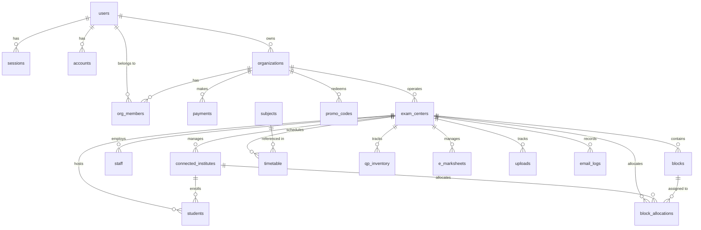

# TestForge (v1.2) – Database Schema Reference

## 1. Overview

The **TestForge** database schema is defined using **Drizzle ORM** (`frontend/src/lib/db/schema.ts`) and targets **PostgreSQL 16** (or NeonDB Serverless PostgreSQL). 

The schema is divided into three distinct functional layers:
1. **Authentication & Billing Layer**: Users, sessions, organizations, promo codes, payments, and audit logs.
2. **Master Data Layer**: Global subjects master.
3. **Exam Center Operational Layer**: Exam centers, connected institutes, students, staff, blocks, timetable, block allocations, QP inventory, marksheets, uploads, and email logs.

---

## 2. Entity Relationship Diagram (ERD)

---

## 3. Detailed Table Specifications

### 3.1 Authentication & Organization Tables

#### `user` (Better Auth User Entity)
| Column | Type | Constraints | Description |
| :--- | :--- | :--- | :--- |
| `id` | `text` | PRIMARY KEY | Unique user identifier |
| `name` | `text` | NOT NULL | User's full name |
| `email` | `text` | NOT NULL, UNIQUE | User email address |
| `email_verified` | `boolean` | NOT NULL | Email verification flag |
| `image` | `text` | NULLABLE | Profile avatar URL |
| `created_at` | `timestamp` | NOT NULL | Creation timestamp |
| `updated_at` | `timestamp` | NOT NULL | Last update timestamp |

#### `session` (Better Auth Active Sessions)
| Column | Type | Constraints | Description |
| :--- | :--- | :--- | :--- |
| `id` | `text` | PRIMARY KEY | Session identifier |
| `token` | `text` | NOT NULL, UNIQUE | Session token stored in cookie |
| `user_id` | `text` | NOT NULL, FK $\rightarrow$ `user.id` (CASCADE) | Associated user |
| `expires_at` | `timestamp` | NOT NULL | Expiration timestamp |
| `ip_address` | `text` | NULLABLE | Client IP |
| `user_agent` | `text` | NULLABLE | Client browser/OS |

#### `organizations` (Billing & Account Root)
| Column | Type | Constraints | Description |
| :--- | :--- | :--- | :--- |
| `id` | `uuid` | PRIMARY KEY, defaultRandom() | Organization ID |
| `name` | `text` | NOT NULL | Institute / Organization name |
| `slug` | `text` | NOT NULL, UNIQUE | URL slug identifier |
| `owner_id` | `text` | NOT NULL, FK $\rightarrow$ `user.id` | Account owner |
| `subscription_tier` | `text` | NOT NULL, DEFAULT `'inactive'` | `inactive`, `trial`, `premium`, `enterprise` |
| `subscription_expires_at`| `timestamp` | NULLABLE | Expiry timestamp |
| `trial_started_at` | `timestamp` | NULLABLE | Trial activation timestamp |
| `trial_ends_at` | `timestamp` | NULLABLE | Trial expiry timestamp |
| `razorpay_customer_id` | `text` | NULLABLE | Razorpay customer ID |
| `settings` | `jsonb` | DEFAULT `{}` | Organization configurations |

#### `org_members` (Organization Members & Roles)
| Column | Type | Constraints | Description |
| :--- | :--- | :--- | :--- |
| `id` | `uuid` | PRIMARY KEY, defaultRandom() | Member record ID |
| `org_id` | `uuid` | NOT NULL, FK $\rightarrow$ `organizations.id` (CASCADE) | Organization |
| `user_id` | `text` | NOT NULL, FK $\rightarrow$ `user.id` (CASCADE) | User |
| `role` | `text` | NOT NULL | `owner`, `admin`, `member`, `staff` |
| `permissions` | `jsonb` | DEFAULT `[]` | Array of permission strings |
*Indexes*: Unique index on `(org_id, user_id)`.

#### `promo_codes` & `payments`
- **`promo_codes`**: Manages promotional discount/trial vouchers (`code`, `type`, `duration_days`, `amount`, `is_used`, `used_by_org_id`, `expires_at`).
- **`payments`**: Tracks Razorpay transactions (`org_id`, `plan_id`, `plan_name`, `amount`, `status`: `pending|paid|failed|refunded`, `razorpay_order_id`, `razorpay_payment_id`, `start_date`, `end_date`).

---

### 3.2 Master & Exam Center Setup Tables

#### `subjects` (Master Curriculum Reference)
| Column | Type | Constraints | Description |
| :--- | :--- | :--- | :--- |
| `id` | `uuid` | PRIMARY KEY, defaultRandom() | Subject ID |
| `code` | `text` | NOT NULL | MSBTE subject paper code (e.g. `22412`) |
| `name` | `text` | NOT NULL | Full course title |
| `scheme` | `text` | NOT NULL | MSBTE curriculum scheme (`K`, `I`, `G`, etc.) |
| `abbr` | `text` | NULLABLE | Subject abbreviation (e.g. `STE-TH`) |
| `is_deleted` | `boolean` | NOT NULL, DEFAULT `false` | Soft delete flag |
*Indexes*: Unique index on `(code, scheme)`.

#### `exam_centers` (Operational Root)
| Column | Type | Constraints | Description |
| :--- | :--- | :--- | :--- |
| `id` | `uuid` | PRIMARY KEY, defaultRandom() | Exam Center ID |
| `org_id` | `uuid` | NOT NULL, FK $\rightarrow$ `organizations.id` (CASCADE) | Parent organization |
| `code` | `text` | NOT NULL | MSBTE Center Code (e.g. `0018`) |
| `name` | `text` | NOT NULL | Center Name |
| `address` | `text` | NULLABLE | Postal address |
| `officer_incharge` | `text` | NULLABLE | Name of Officer In-Charge |
| `sealing_supervisor` | `text` | NULLABLE | Name of Sealing Supervisor |
| `exam_controller` | `text` | NULLABLE | Name of Exam Controller |
| `dist_center_code` | `text` | NULLABLE | Distribution Center Code |
| `dist_center_name` | `text` | NULLABLE | Distribution Center Name |
| `season` | `text` | NULLABLE | `Summer` or `Winter` |
| `exam_year` | `integer`| NULLABLE | Examination Year |
| `start_date` | `timestamp` | NULLABLE | Examination window start |
| `end_date` | `timestamp` | NULLABLE | Examination window end |
| `departments` | `jsonb` | DEFAULT `[]` | Array of department names |
| `is_active` | `boolean` | DEFAULT `true` | Active status |
| `is_deleted` | `boolean` | NOT NULL, DEFAULT `false` | Soft delete flag |
*Indexes*: Unique index on `(org_id)`, composite index on `(org_id, is_active, is_deleted)`.

#### `connected_institutes`
Institutes assigned to sit at this exam center:
| Column | Type | Constraints | Description |
| :--- | :--- | :--- | :--- |
| `id` | `uuid` | PRIMARY KEY, defaultRandom() | Institute record ID |
| `exam_center_id` | `uuid` | NOT NULL, FK $\rightarrow$ `exam_centers.id` (CASCADE) | Exam Center |
| `institute_code` | `text` | NOT NULL | MSBTE Institute Code (e.g. `1740`) |
| `institute_name` | `text` | NOT NULL | Institute Name |
| `is_active` | `boolean` | DEFAULT `true` | Active status |
*Indexes*: Unique index on `(exam_center_id, institute_code)`.

---

### 3.3 Core Examination Operational Tables

#### `students`
| Column | Type | Constraints | Description |
| :--- | :--- | :--- | :--- |
| `id` | `uuid` | PRIMARY KEY, defaultRandom() | Student ID |
| `exam_center_id` | `uuid` | NOT NULL, FK $\rightarrow$ `exam_centers.id` (CASCADE) | Exam Center |
| `connected_institute_id`| `uuid` | NOT NULL, FK $\rightarrow$ `connected_institutes.id` (CASCADE) | Connected institute |
| `seat_number` | `integer` | NOT NULL | MSBTE Seat Number |
| `institute_code` | `text` | NULLABLE | Institute Code |
| `enrollment_number` | `text` | NULLABLE | Student enrollment number |
| `name` | `text` | NULLABLE | Student full name |
| `scheme` | `text` | NULLABLE | Scheme/Branch code (e.g. `CO-5-I`) |
| `subjects` | `jsonb` | DEFAULT `[]` | Array of subject abbreviations |
| `sub_codes` | `jsonb` | DEFAULT `[]` | Array of MSBTE paper codes |
| `is_deleted` | `boolean` | NOT NULL, DEFAULT `false` | Soft delete flag |
*Indexes*: Unique index on `(exam_center_id, seat_number)`, index on `enrollment_number`, index on `(exam_center_id, scheme, is_deleted)`.

#### `blocks` (Exam Rooms)
| Column | Type | Constraints | Description |
| :--- | :--- | :--- | :--- |
| `id` | `uuid` | PRIMARY KEY, defaultRandom() | Block ID |
| `exam_center_id` | `uuid` | NOT NULL, FK $\rightarrow$ `exam_centers.id` (CASCADE) | Exam Center |
| `block_no` | `text` | NOT NULL | Block identifier (e.g. `1`, `2A`) |
| `location` | `text` | NOT NULL | Room / Floor location (e.g. `Room 101, 1st Floor`) |
| `name` | `text` | NOT NULL | Descriptive room name |
| `strength` | `integer` | NOT NULL | Total seating capacity (e.g. `30`) |
| `distribution` | `jsonb` | DEFAULT `[10, 10, 10, 10]` | Row/column layout array |
| `template` | `integer` | DEFAULT `1` | Layout template ID |
| `is_deleted` | `boolean` | NOT NULL, DEFAULT `false` | Soft delete flag |
*Indexes*: Unique index on `(exam_center_id, location)`.

#### `timetable` (Exam Schedule)
| Column | Type | Constraints | Description |
| :--- | :--- | :--- | :--- |
| `id` | `uuid` | PRIMARY KEY, defaultRandom() | Timetable slot ID |
| `exam_center_id` | `uuid` | NOT NULL, FK $\rightarrow$ `exam_centers.id` (CASCADE) | Exam Center |
| `subject_id` | `uuid` | NULLABLE, FK $\rightarrow$ `subjects.id` | Subject reference |
| `exam_day` | `integer` | NULLABLE | Day index (1, 2, 3...) |
| `date` | `timestamp` | NOT NULL | Examination Date |
| `session` | `text` | NOT NULL | `Morning` or `Afternoon` |
| `time_slot` | `text` | NOT NULL | Slot time string (e.g. `09:30 AM - 12:30 PM`) |
| `subject_code` | `text` | NOT NULL | Subject paper code |
| `subject_name` | `text` | NOT NULL | Subject title |
| `scheme` | `text` | NOT NULL | Scheme code |
| `subject_abbr` | `text` | NULLABLE | Subject abbreviation |
| `total_students` | `integer` | DEFAULT `0` | Expected student count |
| `absent_numbers` | `jsonb` | DEFAULT `[]` | Array of absent seat numbers |
| `cps_students` | `jsonb` | DEFAULT `[]` | Copy case student seat numbers |
| `cps_resolved` | `jsonb` | DEFAULT `[]` | Resolved copy case seat numbers |
*Indexes*: Unique index on `(exam_center_id, date, session, subject_code, scheme)`, composite index on `(exam_center_id, date, session)`.

#### `block_allocations` (Seating & Supervisor Assignments)
| Column | Type | Constraints | Description |
| :--- | :--- | :--- | :--- |
| `id` | `uuid` | PRIMARY KEY, defaultRandom() | Allocation ID |
| `exam_center_id` | `uuid` | NOT NULL, FK $\rightarrow$ `exam_centers.id` (CASCADE) | Exam Center |
| `connected_institute_id`| `uuid` | NULLABLE, FK $\rightarrow$ `connected_institutes.id` (SET NULL) | Institute |
| `date` | `timestamp` | NOT NULL | Exam Date |
| `session` | `text` | NOT NULL | `Morning` or `Afternoon` |
| `timeslot` | `text` | NULLABLE | Time slot string |
| `block_id` | `uuid` | NULLABLE, FK $\rightarrow$ `blocks.id` | Allocated block |
| `block_no` | `text` | NULLABLE | Block number snapshot |
| `location` | `text` | NULLABLE | Location snapshot |
| `scheme` | `text` | NOT NULL | Scheme |
| `subject_code` | `text` | NOT NULL | Subject paper code |
| `subject_name` | `text` | NOT NULL | Subject name |
| `seat_numbers` | `jsonb` | NOT NULL | Array of allocated seat numbers |
| `first_seat` | `integer` | NULLABLE | Minimum seat number in block |
| `last_seat` | `integer` | NULLABLE | Maximum seat number in block |
| `assigned_count` | `integer` | NULLABLE | Count of allocated students |
| `strength` | `integer` | NULLABLE | Capacity snapshot |
| `supervisor_uid` | `text` | NULLABLE | Assigned supervisor UID |
| `supervisor_name` | `text` | NULLABLE | Assigned supervisor Name |
*Indexes*: Unique index on `(exam_center_id, date, session, block_id, subject_code)`.

#### `staff` (Supervisors & Invigilators)
| Column | Type | Constraints | Description |
| :--- | :--- | :--- | :--- |
| `id` | `uuid` | PRIMARY KEY, defaultRandom() | Staff ID |
| `exam_center_id` | `uuid` | NOT NULL, FK $\rightarrow$ `exam_centers.id` (CASCADE) | Exam Center |
| `uid` | `text` | NOT NULL | Staff Unique ID / Employee Code |
| `name` | `text` | NOT NULL | Full Name |
| `department` | `text` | NOT NULL | Academic Department |
| `email` | `text` | NULLABLE | Email address |
| `staff_type` | `text` | NOT NULL | `Internal` or `External` |
| `role` | `text` | NULLABLE | `Supervisor`, `Reliever`, `Control Room` |
| `designation` | `text` | NULLABLE | Academic designation (e.g. `Lecturer`) |
| `post_held_in_examination`| `text` | NULLABLE | Exam post |
| `is_deleted` | `boolean` | NOT NULL, DEFAULT `false` | Soft delete flag |
*Indexes*: Unique index on `(exam_center_id, uid)`.

---

### 3.4 Auxiliary Operational Tables

- **`qp_inventory`**: Tracks question paper packets (`exam_center_id`, `day`, `date`, `session`, `subject_code`, `expected_students`, `expected_packets`, `received_packets`, `received_qps`). Unique index on `(exam_center_id, date, session, subject_code)`.
- **`e_marksheets`**: Stores marksheet ledger records (`exam_center_id`, `sheet_no`, `subject_name`, `scheme`, `subject_head`, `paper_code`, `file_name`, `processed_at`).
- **`uploads`**: Tracks ingestion files (`exam_center_id`, `file_type`, `original_filename`, `stored_filename`, `file_hash`, `file_size`, `status`: `UPLOADED|PROCESSING|PROCESSED|FAILED`, `record_count`, `error_message`, `metadata`, `connected_institute_id`, `processed_at`). Unique index on `(exam_center_id, file_type, connected_institute_id)`.
- **`email_logs`**: Tracks Resend email deliveries (`org_id`, `exam_center_id`, `user_id`, `recipient_email`, `recipient_name`, `subject`, `order_type`, `order_key`, `status`, `error_message`, `sent_at`).
- **`orders`**: Tracks generated staff appointment orders (`exam_center_id`, `staff_id`, `order_type`, `date`, `session`, `order_key`, `sent_at`).
- **`audit_logs`**: Security and change log (`org_id`, `user_id`, `action`, `entity_type`, `entity_id`, `old_values`, `new_values`, `ip_address`, `user_agent`).
